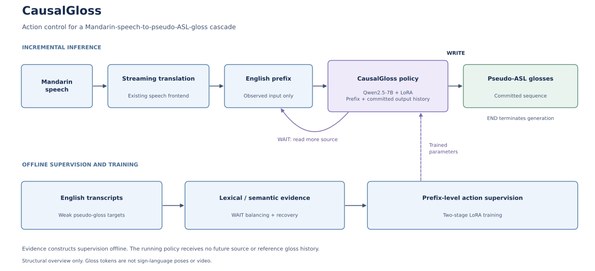

# CausalGloss

**Multi-Evidence Action Control for a Simultaneous Mandarin Speech-to-ASL Gloss Cascade**

Mingze Li · Satoshi Nakamura · ICASSP 2027 submission

CausalGloss learns when to wait for more English input and when to commit a pseudo-ASL gloss.
In the speech cascade, an existing streaming translation frontend converts Mandarin speech into incremental English prefixes.
The policy uses the observed prefix and its own committed output history to select WAIT, WRITE, or END.

The method constructs prefix-level action supervision from lexical and semantic evidence, then adds WAIT balancing and recovery from incomplete output histories.
The implementation includes Qwen2.5-7B-Instruct LoRA training, fixed and learned baselines, component ablations, and text/speech evaluation.

The method is named **CausalGloss**; the repository retains its original name, `CasualGloss`.
This repository covers the submitted gloss paper and its required dependencies. It does not include later pose/video extensions.

## System overview



Lexical and semantic alignment are used to construct training supervision. They are not future-source or reference inputs to the running policy.
WRITE keeps the current source prefix, allowing several glosses to be emitted before another WAIT.
See the [editable diagram source](figures/system-overview.mmd) and [paper-to-code map](docs/PAPER_TO_CODE.md).

## Reported results

The table reproduces **Table 1 of the submitted paper**, using the frozen Locked500 English-to-pseudo-gloss evaluation.
Values are means ± sample standard deviations over three training seeds. Higher is better for F1, sequence similarity and BLEU; lower is better for LAAL.

| System | Token F1 ↑ | Sequence similarity ↑ | BLEU-4 ↑ (post-hoc) | LAAL ↓ (source tokens) |
| --- | ---: | ---: | ---: | ---: |
| Fixed Wait-k, k = 7 | 0.6457 ± 0.0010 | 0.6383 ± 0.0008 | 33.90 ± 0.19 | 4.3099 ± 0.0528 |
| TransLLaMA-style, k = 5 | 0.7067 ± 0.0056 | 0.6955 ± 0.0051 | 28.35 ± 0.33 | 3.9061 ± 0.0458 |
| **CausalGloss** | 0.7047 ± 0.0055 | 0.6957 ± 0.0060 | 37.31 ± 2.88 | 1.7823 ± 0.2031 |

These are aggregates of the historical predictions used in the paper, not newly generated predictions.
Source-token LAAL measures waiting for source input; it is not GPU inference time or end-to-end speech latency.
The learned comparator is a task-adapted TransLLaMA-style baseline, not an exact reproduction of the original system.

The displayed values are recorded in [expected_paper_results.json](results/expected_paper_results.json).
The underlying aggregates, including CLERC human-reference evaluation, ablations and the synthetic-speech cascade, are in [paper_results.json](results/paper_results.json).
See [evaluation protocols](docs/EVALUATION.md) for metrics and uncertainty estimates.

## Input/output example

The following is a **hand-constructed illustration of action semantics**, not a model prediction, benchmark example, or expert-validated ASL translation.
Its English input and toy gloss tokens are invented for this explanation.

English input: `The cat sleeps`

| Observed English prefix before the action | Action | Committed toy pseudo-gloss after the action |
| --- | --- | --- |
| `The` | WAIT: read one more source token | empty |
| `The cat` | WRITE `CAT` | `CAT` |
| `The cat` | WAIT: read one more source token | `CAT` |
| `The cat sleeps` | WRITE `SLEEP` | `CAT SLEEP` |
| `The cat sleeps` | END | `CAT SLEEP` |

The initial prefix contains one source token, as in the sentence-level evaluator.
The action names above describe the state transitions; WRITE commits the predicted gloss token itself.
See [the rollout implementation](method/causalgloss/evaluate_free_running_rollout.py).

## Quick start

For source inspection and CPU checks:

```bash
git clone https://github.com/OwenLmz/CasualGloss.git
cd CasualGloss
python -m pip install -r requirements/analysis.txt
```

```bash
python scripts/paper.py list
python scripts/check_release.py
python -m unittest discover -s tests -v
python -m unittest discover -s tests/verification -v
```

These checks do not run model training or reproduce benchmark predictions.
Training and inference require the corresponding ML environment, frozen data and selected adapters.
The [running guide](docs/REPRODUCTION.md) describes saved-prediction rescoring, the 82-output checkpoint matrix, and the 30-invocation training plan.
Text-policy, TTS and SeamlessStreaming environments are documented separately in [requirements](requirements/README.md).

## Code and documentation

| Component | Implementation |
| --- | --- |
| Main policy, training and free-running inference | [method/causalgloss](method/causalgloss) |
| Weak pseudo-gloss targets, alignments and recovery examples | [data_preparation](data_preparation) |
| Upstream weak-gloss model training | [training/upstream_gloss](training/upstream_gloss) |
| Fixed Wait-k, TransLLaMA-style and speech lexical control | [baselines](baselines) |
| Five component ablations | [ablations](ablations) |
| CLERC evaluation and paper-result scoring | [evaluation/clerc](evaluation/clerc), [scripts/verification](scripts/verification) |
| Synthetic corpus and speech cascade | [speech](speech) |
| Configurations, figures and original-paper aggregates | [configs](configs), [figures](figures), [results](results) |

Suggested entry points are [the rollout evaluator](method/causalgloss/evaluate_free_running_rollout.py),
[action datasets and collation](method/causalgloss/causal_action_common.py),
and [the policy trainer](method/causalgloss/train_qwen_lora_causal_ddp.py).
Further documentation covers [data and models](docs/DATA_AND_MODELS.md),
[evaluation](docs/EVALUATION.md), [running experiments](docs/REPRODUCTION.md),
[repository scope](docs/SCOPE.md), and a [Chinese reading guide](docs/LEARNING_GUIDE_ZH.md).

## Data, models and interpretation

As of 19 November 2026, this repository and its existing [Release attachments](https://github.com/OwenLmz/CasualGloss/releases/tag/paper-reproduction-20261016) are public.
The release contains frozen experiment data, selected LoRA adapters, saved predictions and required synthetic audio; ordinary `git clone` retrieves the source and catalogs only.
Historical release notes may describe their earlier private-access status.
Public availability does not grant new rights to redistribute upstream data, models, or their derivatives.
Asset catalogs and checksums are in [release_assets.json](provenance/release_assets.json); access instructions and conditions are in [DATA_AND_MODELS.md](docs/DATA_AND_MODELS.md) and [THIRD_PARTY.md](THIRD_PARTY.md).

Important interpretation boundaries:

- Weak pseudo-gloss targets are not expert ASL gold annotations, and overlap scores do not establish ASL comprehensibility.
- Locked500 separates the downstream policy partitions, but its examples occur in upstream weak-gloss training. Evaluation generation caps also depend on reference length; see [data lineage](docs/DATA_AND_MODELS.md) and [evaluation settings](docs/EVALUATION.md).
- Speech evaluation uses synthetic Mandarin audio, and output over-generation remains unresolved. The system outputs gloss tokens, not sign-language poses or video.
- Source checks and saved-prediction rescoring do not establish complete retraining or exact checkpoint reproduction. The [historical verification record](https://github.com/OwenLmz/CasualGloss/blob/paper-source-20261017/docs/VERIFICATION.md) reports differences in fresh checkpoint inference.

No blanket open-source license has yet been selected for the authors' code.
Data, model and code permissions remain separate; see [THIRD_PARTY.md](THIRD_PARTY.md).
